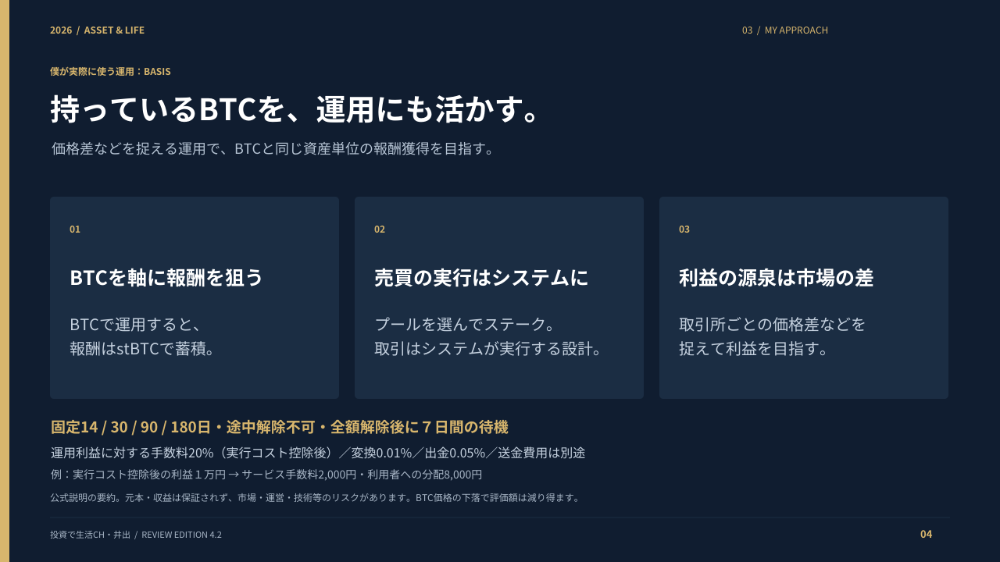
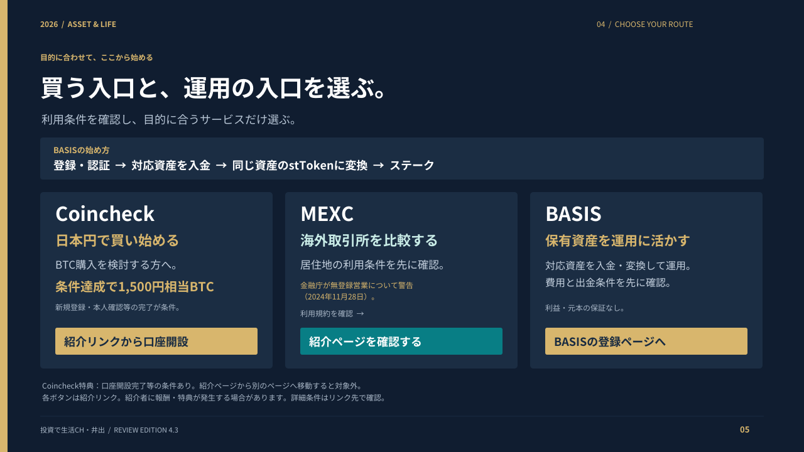

# 僕の資産戦略を、この一冊に。

## 現行レビュー版 v4.3

[PDFをダウンロード（横型５ページ・約1.7MB）](https://github.com/yoshida0856/-/raw/refs/heads/main/manuals/basis-manual-v4.3.pdf)

配布時の案内に合わせて、本人の実際の資産配分・注目銘柄候補・実際に利用するBASISを中心に再構成しました。

1. 表紙
2. 本人申告の現在の資産配分（2026年10月12日確認）
3. 公開情報から選んだPAXG・LINKの研究候補
4. 本人が利用するBASISの訴求・特徴と条件
5. 登録・認証 → 入金 → stTokenへの変換 → ステークの始め方

銘柄は依頼に応じて編集上選定した候補で、本人の保有・推奨を示しません。独自情報・非公開情報ではありません。運用期間・元本・損益・出金実績の具体値は未提供で、創作していません。収益の安定性を保証する内容ではありません。候補銘柄は配布前に本人による最終確認を想定したレビュー案です。

## 確認資料

- PAXG発行体：https://www.paxos.com/paxgold
- Chainlink公式：https://docs.chain.link/getting-started/conceptual-overview
- BASIS：https://docs.basis.pro/
- 成功報酬：https://docs.basis.pro/economics-and-rewards/performance-fee-mechanics
- 解除：https://docs.basis.pro/economics-and-rewards/unstaking-and-7-day-rule
- リスク：https://docs.basis.pro/risk-safety-and-asset-protection/risk-disclosure

BASISの条件は2026年10月11日取得の資料を参照。PAXG・Chainlinkの公式説明は2026年10月12日に取得。実際の安全性・収益性・日本での必要な登録の独立検証ではありません。

４ページ目は「持っているBTCを運用にも活かす」を主題に変更。手数料の説明を「運用利益に対する手数料20％」とし、実行コスト控除後の利益１万円なら手数料2,000円・分配8,000円という仮の例を追加しています。

## 登録案内

５ページ目にCoincheck・MEXC・BASISの役割別の紹介導線を掲載し、BASISの開始手順も保持しました。

- Coincheck：https://campaign.coincheck.com/invitation?code=RzLuJLQ
- MEXC：https://promote.mexc.com/a/VlM5ZfOs
- BASIS：https://basis.pro/register/IUMS4759

Coincheckの公式キャンペーンページを2026年10月12日に表示・確認。1,500円相当BTCの付与には新規登録・本人確認・税務上の届出等による口座開設完了が必要で、既存アカウント等は対象外です。紹介ページから別ページへ移動すると対象外になる旨も記載されています。キャンペーンは変更・終了され得るためリンク先の最新条件を優先してください。

MEXCは日本居住者向けのため無条件の推奨として扱わず、規約確認と紹介ページの案内としています。金融庁の2024年11月28日付警告を短く注記しています。確認資料：https://www.fsa.go.jp/policy/virtual_currency02/mexc_global_keikokushiryo.pdf

紹介リンクには利益相反の簡潔な開示を付けています。別のアフィリエイト案件への切替は比較情報がなく推奨していません。

## 過去版

- [v4.2：BASIS訴求と手数料説明](basis-manual-v4.2.pdf)

- [v4.1：特徴と始め方](basis-manual-v4.1.pdf)

- [v4.0：個人戦略５ページ版](basis-manual-v4.0.pdf)

- [v2.0：横型13ページ](basis-manual-v2.0.pdf)
- [v1.2：縦型12ページ](basis-manual-v1.2.pdf)

## 修正用ソース

`source/design_v4_3.py` に生成用スクリプトを保持しています。再生成にはPython・PyMuPDF・Noto Sans CJKの通常体と太字が必要です。レビュー用PDFはページ画像版で、リンクを保持しています。
