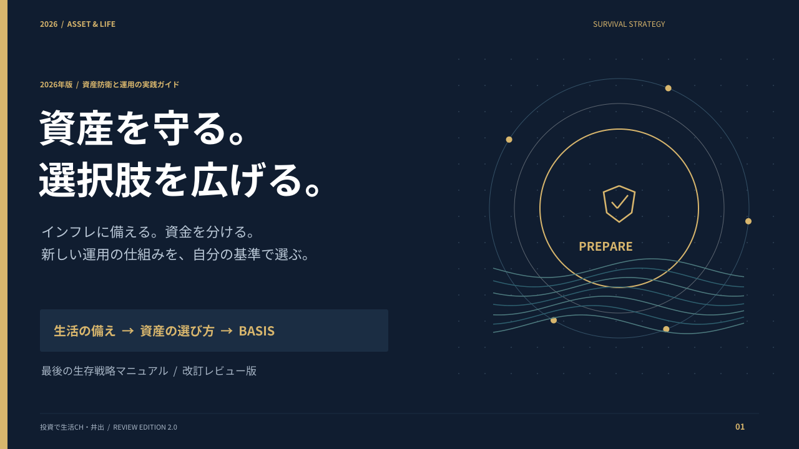
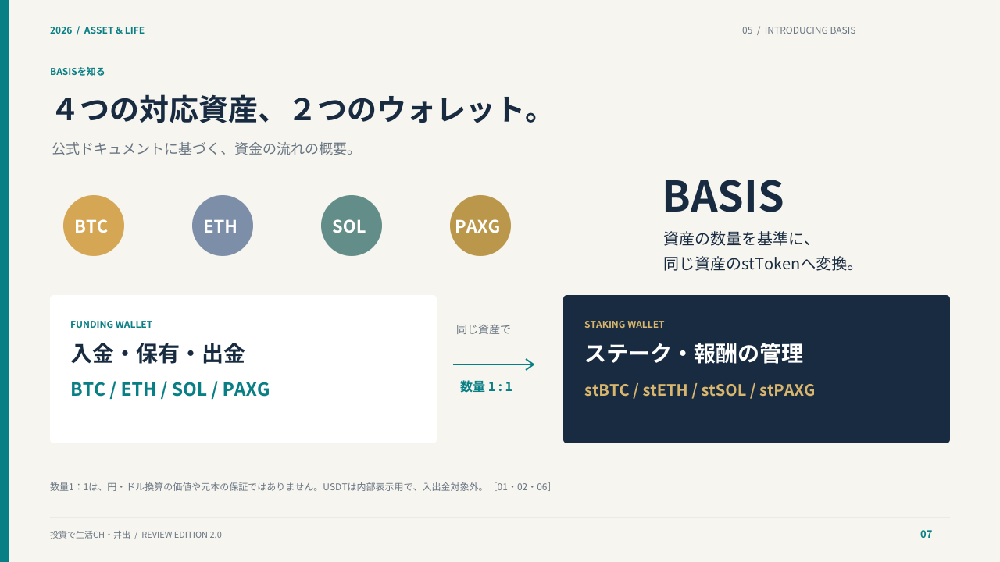
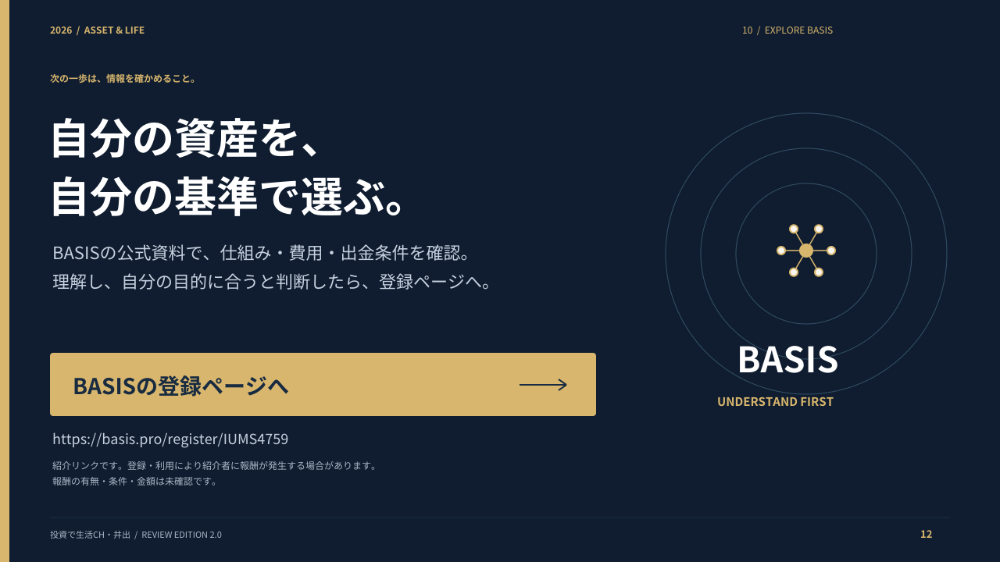

# 資産防衛と運用の実践ガイド

## 現行レビュー版 v2.0

[PDFをダウンロード（横型13ページ・約4.2MB）](https://github.com/yoshida0856/-/raw/refs/heads/main/manuals/basis-manual-v2.0.pdf)

濃紺・ゴールド・青緑の配色、図解、比較カード、手順、登録ボタンを使って全面的に再構成したレビュー版です。内容・デザインとも修正可能です。

BASISの公式ドキュメントを2026年10月11日に取得し、対応資産・手数料・成功報酬・出金待機期間等の記載を反映しました。資料の末尾にクリック可能な確認先を掲載しています。公式説明の要約であり、運用実績や日本での必要な登録状況の独立検証ではありません。

## 前版

[v1.2（縦型12ページ）](basis-manual-v1.2.pdf)

## 修正用ソース

生成用スクリプトは `source/design_v2.py` に保存しています。再生成にはPython・PyMuPDF・Noto Sans CJKの通常体と太字が必要です。レビュー用PDFは表示の互換性と容量を優先したページ画像版で、リンクは保持しています。
