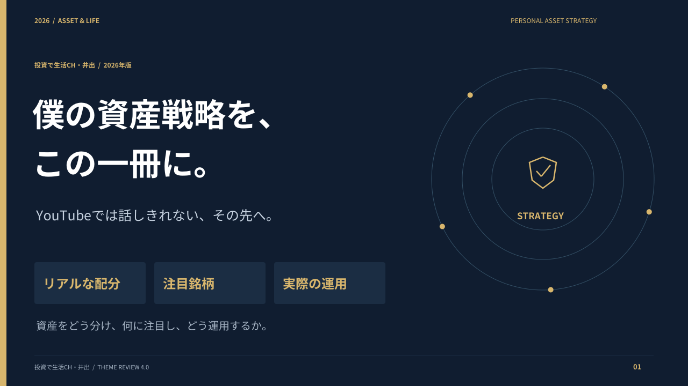
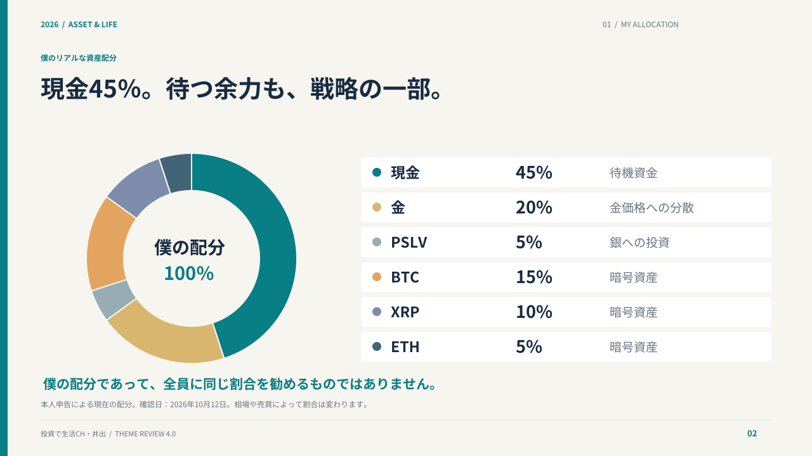
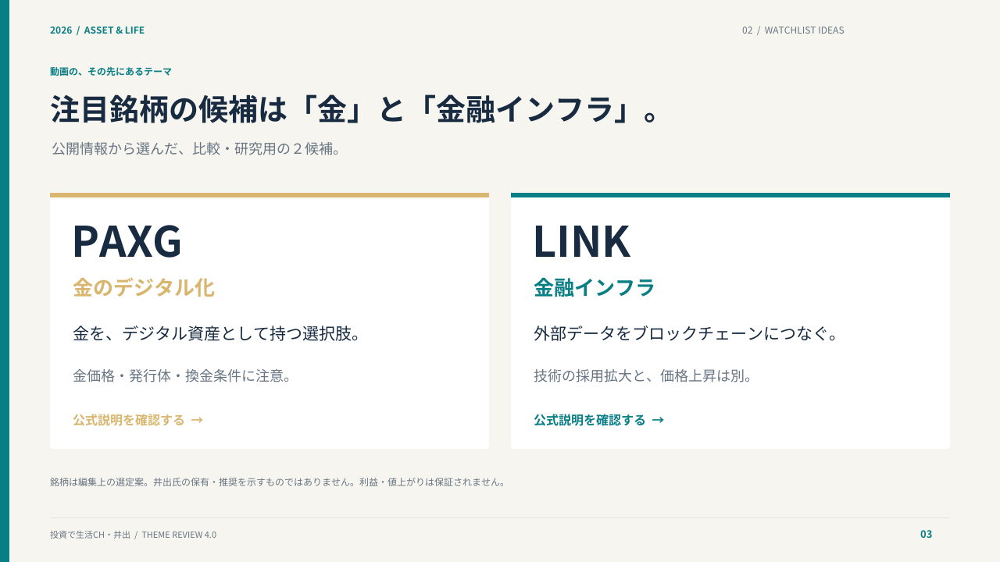
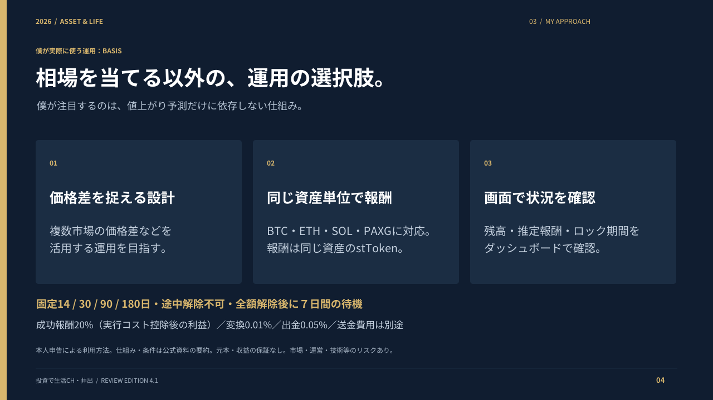
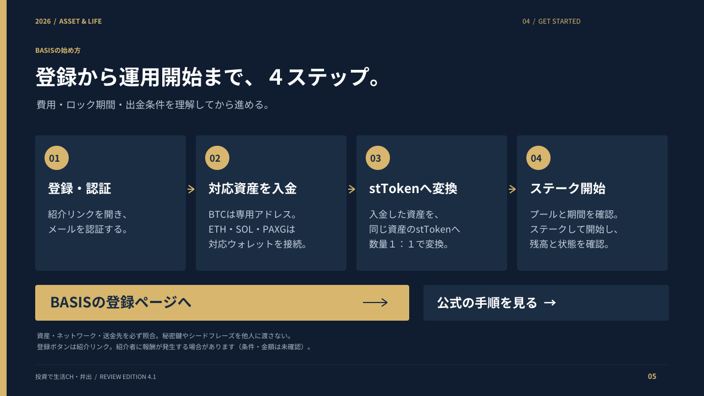

# 僕の資産戦略を、この一冊に。

## 現行レビュー版 v4.1

[PDFをダウンロード（横型５ページ・約1.6MB）](https://github.com/yoshida0856/-/raw/refs/heads/main/manuals/basis-manual-v4.1.pdf)

配布時の案内に合わせて、本人の実際の資産配分・注目銘柄候補・実際に利用するBASISを中心に再構成しました。

1. 表紙
2. 本人申告の現在の資産配分（2026年10月12日確認）
3. 公開情報から選んだPAXG・LINKの研究候補
4. 本人が利用するBASISの訴求・特徴と条件
5. 登録・認証 → 入金 → stTokenへの変換 → ステークの始め方

銘柄は依頼に応じて編集上選定した候補で、本人の保有・推奨を示しません。独自情報・非公開情報ではありません。運用期間・元本・損益・出金実績の具体値は未提供で、創作していません。収益の安定性を保証する内容ではありません。候補銘柄は配布前に本人による最終確認を想定したレビュー案です。

## 確認資料

- PAXG発行体：https://www.paxos.com/paxgold
- Chainlink公式：https://docs.chain.link/getting-started/conceptual-overview
- BASIS：https://docs.basis.pro/
- 成功報酬：https://docs.basis.pro/economics-and-rewards/performance-fee-mechanics
- 解除：https://docs.basis.pro/economics-and-rewards/unstaking-and-7-day-rule
- リスク：https://docs.basis.pro/risk-safety-and-asset-protection/risk-disclosure

BASISの条件は2026年10月11日取得の資料を参照。PAXG・Chainlinkの公式説明は2026年10月12日に取得。実際の安全性・収益性・日本での必要な登録の独立検証ではありません。

## 過去版

- [v4.0：個人戦略５ページ版](basis-manual-v4.0.pdf)

- [v2.0：横型13ページ](basis-manual-v2.0.pdf)
- [v1.2：縦型12ページ](basis-manual-v1.2.pdf)

## 修正用ソース

`source/design_v4_1.py` に生成用スクリプトを保持しています。再生成にはPython・PyMuPDF・Noto Sans CJKの通常体と太字が必要です。レビュー用PDFはページ画像版で、リンクを保持しています。
